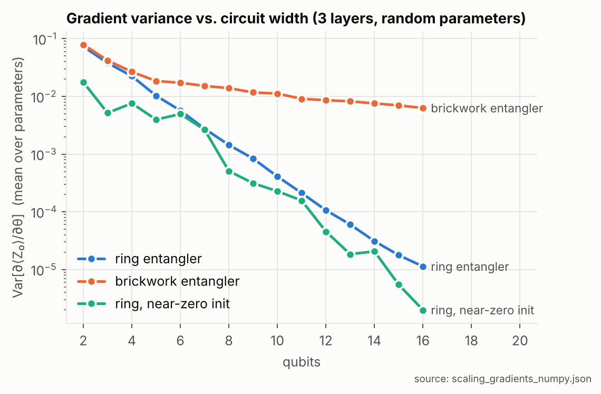
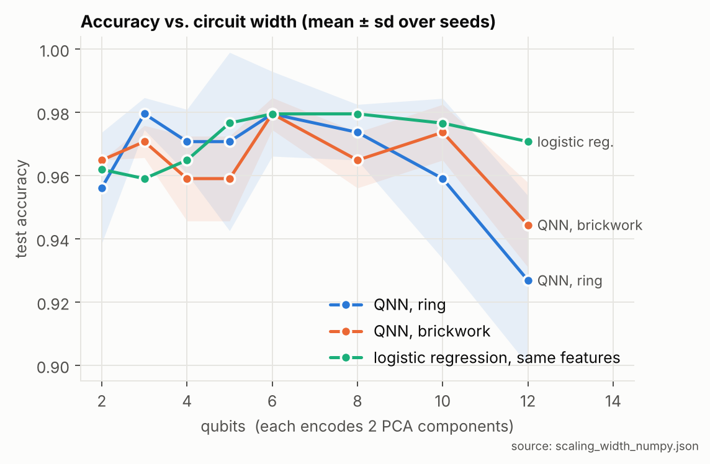
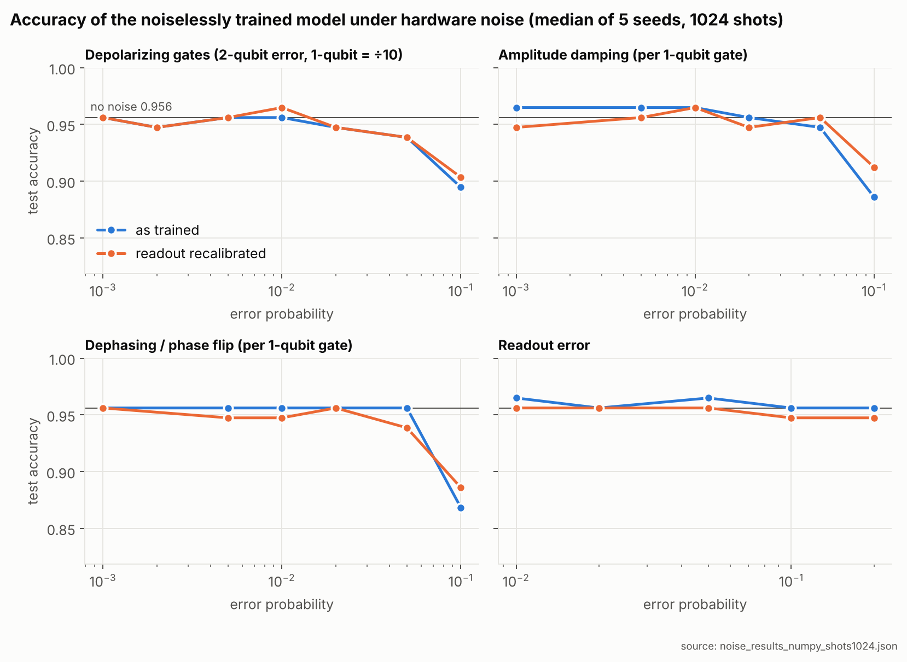

# Scaling and noise experiments

Two follow-up studies on the v2 hybrid QNN (see `RESULTS_V2.md` for the baseline model).
Code is in `experiments/`, figures in `experiments/figures/`, raw numbers in `experiments/*.json`.

> **Status.** Every number below comes from exact NumPy simulators of the same circuits
> (statevector, adjoint-gradient and density-matrix). `tests/test_simulators.py` checks them
> against independent dense-matrix references: 75 checks, max error ~1e-15 in double precision
> and ~1e-6 for the single-precision density-matrix path used for speed. On a CUDA-Q machine
> (WSL2, NVIDIA GPU) all 75 checks pass, the CUDA-Q kernel matches the NumPy simulator to ~1e-15
> for both the ring and brickwork circuits (`quantum_nn.py --check-backend`), and CUDA-Q's
> density-matrix noise model matches the NumPy one to ~1e-6 for every noise type and both entanglers
> (`experiments/noise_study.py --check`). The full exact-expectation noise sweep was also rerun on
> CUDA-Q (`experiments/noise_results_cudaq.json`, 5 seeds), and all 1,325 reported metric values are
> identical to the NumPy run. A 1024-shot rerun would differ slightly only because the two
> simulators draw random shots differently.

---

## 1. Barren plateaus: why the circuit doesn't scale, and a fix

**Question.** If you add qubits (and features), can the model still be trained?

**Method.** For n = 2 to 16 qubits (3 layers, n qubits encode 2n PCA components), draw 200
random parameter vectors and training inputs and compute the exact gradient of ⟨Z₀⟩ with
respect to every parameter. A barren plateau is gradient variance that shrinks exponentially
with n, so on hardware the gradients disappear into measurement noise.



| Entangler | Var[∂⟨Z₀⟩/∂θ] at 4 qubits | 8 | 12 | 16 | Fitted decay |
|---|---|---|---|---|---|
| Ring (v2 default) | 2.3e-2 | 1.4e-3 | 1.1e-4 | 1.1e-5 | ×0.53 per qubit (2^-0.92n) |
| Ring, near-zero init | 7.6e-3 | 5.1e-4 | 4.6e-5 | 2.0e-6 | ×0.50 per qubit |
| **Brickwork** | 2.7e-2 | 1.4e-2 | 8.6e-3 | 6.3e-3 | ~1/n (polynomial) |

**Findings.**
- **The ring entangler has a barren plateau.** Gradient variance roughly halves with every added
  qubit and is about 6,500× smaller at 16 qubits than at 2. At random initialisation the circuit's
  output variance collapses the same way (5.5e-2 at 4 qubits, 4.3e-5 at 16), so a wide ring
  circuit starts out giving nearly the same output for every patient. At 4–6 qubits the gradients
  are still healthy, so the v2 model (4 qubits) is unaffected.
- **Initialisation doesn't fix it; the observable becoming global does cause it.** Starting the
  parameters near zero, a common remedy, didn't help. Working backwards from the measurement,
  one ring layer turns Z₀ into Z₁Z₂⋯Zₙ₋₁, a parity over every other qubit. This is the
  global-cost mechanism described by Cerezo et al. (2021).
- **Brickwork fixes it.** CNOTs on pairs (0,1),(2,3),… then (1,2),(3,4),…, with the same number of
  parameters, leave Z₀ unchanged at each CNOT layer. ⟨Z₀⟩ therefore depends only on a light cone of
  neighbouring qubits. Output variance stays flat (0.17 at 4 qubits, 0.15 at 16), and gradient
  variance falls only like 1/n, because a growing share of parameters sit outside the light cone
  with zero gradient. Brickwork gradients are about **80× larger** than the ring's at 12 qubits
  and **560× larger** at 16.
- **Caveat: depth differs too.** The ring's CNOT chain runs sequentially, about n CNOT-steps per
  layer, while brickwork takes 2 per layer. So the comparison is "same parameters", not "same
  depth". The shallower, local brickwork circuit is also cheaper on hardware.

---

## 2. Accuracy vs. circuit width

**Question.** Do more qubits (and therefore more features) give a better classifier, and
does the brickwork fix carry over to trained accuracy?

**Method.** n qubits encode 2n PCA components (RY on each qubit, then RZ). That is 4 features at
2 qubits and 24 at 12, which keeps 99.9% of the variance. Each width was trained with the v2
recipe (Adam, lr 0.05, early stopping on validation loss, up to 80 epochs) for 3 seeds and both
entanglers. The same exact gradients were computed with the adjoint method, which is faster on a
CPU than parameter shift. Test accuracy is at threshold 0.5, and logistic regression on the
identical features is the reference.



| Qubits (features) | QNN, ring | QNN, brickwork | Logistic regression, same features |
|---|---|---|---|
| 2 (4) | 95.6% ± 1.8 | 96.5% ± 0.0 | 96.2% |
| 3 (6) | 98.0% ± 0.5 | 97.1% ± 0.5 | 95.9% |
| 4 (8) | 97.1% ± 1.0 | 95.9% ± 1.3 | 96.5% |
| 6 (12) | 98.0% ± 1.3 | 98.0% ± 0.5 | 98.0% |
| 8 (16) | 97.4% ± 0.9 | 96.5% ± 0.9 | 98.0% |
| 10 (20) | 95.9% ± 2.5 (AUC 0.995) | 97.4% ± 0.9 (AUC 0.998) | 97.7% |
| 12 (24) | 92.7% ± 2.7 (AUC 0.982) | 94.4% ± 1.3 (AUC 0.987) | 97.1% |

**Findings.**
- **More qubits don't make a better classifier here.** Both circuits peak at about 3–6
  qubits (6–12 features). The ring declines from 10 qubits and both are down by 12, while
  logistic regression stays at 96–98% throughout.
  Extra PCA components carry little signal on this dataset, and the wider circuits are harder
  to train.
- **Brickwork degrades more gently, in line with the gradient study.** At 10 and 12 qubits it
  beats the ring by 1.5–1.7 points with about half the seed-to-seed spread, and has higher AUC.
  With 3 seeds and a 114-patient test set the bands overlap, so read this as consistent with
  the barren-plateau result, not as proof on its own.
- **At 12 qubits both versions still trail logistic regression** (94.4% / 92.7% vs. 97.1%).
  Avoiding the barren plateau keeps a wide circuit trainable. It doesn't give it an advantage.
- These are test-set comparisons across many configurations, so they are for understanding
  scaling, not for picking a new model. The 3-qubit ring at 98.0% is not a new headline: the v2
  configuration was chosen on validation data before this study.

---

## 3. Hardware noise

**Question.** How does the trained 4-qubit model hold up on noisy hardware, and what does it
cost to fix?

**Method.** Density-matrix simulation with a noise channel after every gate (encoding and
trainable), using CUDA-Q's channel probability conventions:
- **depolarizing:** 1-qubit error p₁ after every RY/RZ, 2-qubit error p₂ = 10·p₁ after every CNOT
- **amplitude damping** (T1-like decay toward |0⟩) after every 1-qubit gate
- **dephasing** (phase flip) after every 1-qubit gate
- **symmetric readout error**

⟨Z₀⟩ is estimated from **1024 measurement shots**, as on hardware. Each of 5 trained models (one
per seed) is scored on the fixed 114-patient test set:
- **(a) as trained**
- **(b) after refitting only the 2 classical readout parameters** (w, b) on the noisy
  **validation** set, which never touches test data



Median over 5 seeds, with the worst seed in parentheses, at 1024 shots:

| Noise (per gate) | Accuracy as trained | After readout recalibration | AUC |
|---|---|---|---|
| none (shot noise only) | 95.6% | n/a | 0.994 |
| depolarizing 2-qubit 1% / 1-qubit 0.1%, readout 1% | 95.6% (93.9) | 95.6% (94.7) | 0.995 |
| depolarizing 2-qubit 5% / 1-qubit 0.5%, readout 2% | 93.9% (87.7) | 93.9% (92.1) | 0.991 |
| depolarizing 2-qubit 10% / 1-qubit 1% | 89.5% (57.9) | 90.3% (87.7) | 0.975 |
| amplitude damping 10% | 88.6% (54.4) | 91.2% (86.0) | 0.974 |
| dephasing 10% | 86.8% (51.8) | 88.6% (87.7) | 0.954 |
| readout error 20% | 95.6% (90.4) | 94.7% (93.9) | 0.993 |

**Findings.**
- **At realistic error rates the model loses nothing.** At roughly current-hardware levels
  (1% per 2-qubit gate, 0.1% per 1-qubit gate, 1% readout) accuracy matches the noise-free
  model at the same shot count: 95.6% vs. 95.6%.
- **Noise mostly damages calibration before ranking.** Gate noise shrinks ⟨Z₀⟩ toward 0, and
  amplitude damping also shifts it. Patients stay mostly in the same order (AUC ≥ 0.99 up to 5%
  error), but the fixed decision threshold drifts. Above 5% the shrunken signal starts to sink
  into shot noise, and AUC falls to 0.95–0.98 at 10%.
- **Recalibration prevents catastrophic failures.** One of the five models collapses to 52–58%
  under 10% gate noise as trained, because its threshold sits where the noise pushes the signal.
  Refitting w and b on noisy validation data lifts the worst seed to 86–88% at every 10% level.
  The median gain is small (about 1–3 points), and at low noise recalibration costs up to one test
  patient.
- **Noise-aware training made no meaningful difference.** It was run with exact expectation
  values on 3 seeds. Training with the noise in the loop gave 96.5% (light noise) and
  97.4% ± 0.9 (heavy), against 96.8% ± 0.5 for recalibration on the same seeds, within one test
  patient. Recalibration is far cheaper. The parameter-shift rule stays exact with noise because
  the channels don't depend on θ.
- With exact expectation values (infinite shots) every 10% case recovers to 94.7–96.7% after
  recalibration, with AUC ≥ 0.99 (`noise_results_numpy.json`). The gap from the table above is
  what finite sampling costs.

**Limitations of the noise model.**
- Noise is applied after RZ as well as RY. On superconducting hardware RZ is usually a virtual,
  error-free gate.
- There is no idle noise while qubits wait during the sequential CNOT chain.
- Amplitude damping and dephasing are applied only after 1-qubit gates.
- p is the Kraus error probability, not average gate infidelity (that is 2p/3 for one qubit and
  4p/5 for two), so the "realistic" labels are slightly pessimistic.

## Reproduce on a CUDA-Q machine (Linux / WSL2 with an NVIDIA GPU)

```bash
python tests/test_simulators.py                       # NumPy simulators vs dense references
python quantum_nn.py --check-backend                  # CUDA-Q kernel vs NumPy (ring + brickwork)
python experiments/noise_study.py --check             # CUDA-Q noise model vs density-matrix sim

# barren plateau on CUDA-Q, extended past what the CPU reference covered
python experiments/scaling_study.py --part gradients --backend cudaq --min-qubits 2 --max-qubits 20 --samples 100

# accuracy vs width on GPU, including the full 30-feature, 15-qubit model (slow: parameter shift)
python experiments/scaling_study.py --part width --backend cudaq --widths 4 8 12 15 --seeds 0

# noise sweeps on CUDA-Q's density-matrix simulator at 1024 shots (skips the slow noise-aware training)
python experiments/noise_study.py --backend cudaq --seeds 0 1 2 3 4 --noise-aware-seeds --eval-shots 1024

python experiments/plot_results.py                    # rebuild every figure (prefers CUDA-Q results)
```

Results are written to `experiments/` (`*_cudaq.json` next to the existing `*_numpy.json`),
and `plot_results.py` uses the CUDA-Q files when they exist.
