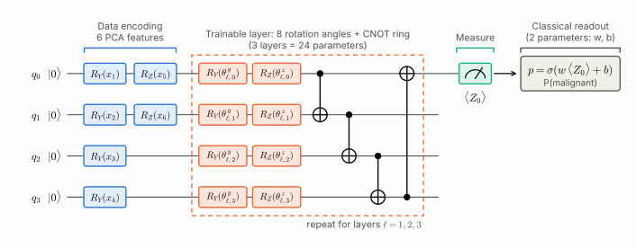

# Hybrid Quantum-Classical Classifier with CUDA-Q

A variational quantum classifier with a trainable classical readout for the Wisconsin Diagnostic
Breast Cancer dataset, simulated with NVIDIA CUDA-Q and compared against classical baselines on
identical data splits.

**Headline** (10 seeds, fixed 114-patient test set, reproduced exactly on CUDA-Q; see [RESULTS_V2.md](RESULTS_V2.md)):
the hybrid QNN reaches **96.6% accuracy, 95.0% sensitivity** (about 2 of 42 cancers missed) and
**AUC 0.996** with 4 qubits and 26 trainable parameters. It matches classical models on the same
6 features; it does not beat them.



## What is here

| Path | Contents |
|---|---|
| `quantum_nn.py` | The whole v2 pipeline: data, circuit, training, evaluation, baselines, ensemble |
| `tune_qnn.py` | Hyperparameter search scored on the validation split only |
| [`RESULTS_V2.md`](RESULTS_V2.md) | Measured results and what they do and don't show |
| [`EXPERIMENTS.md`](EXPERIMENTS.md) | Scaling study (barren plateau, brickwork entangler, accuracy vs. width) and hardware-noise study |
| [`CHANGES.md`](CHANGES.md) | Every bug fixed and improvement made since v1, with reasons |
| `results_v2*.json`, `tuning_v2.json` | Raw outputs behind RESULTS_V2.md |
| `experiments/` | Code, raw results and figures for EXPERIMENTS.md (`draw_circuit.py` draws the circuit above) |
| `tests/` | Simulator correctness tests: `python tests/test_simulators.py` |
| [`legacy/`](legacy/README.md) | The v1 scripts and reports, kept for reference; their numbers are not reliable (see CHANGES.md) |

## Setup

Linux or WSL2 (CUDA-Q has no native Windows build):

```bash
python3 -m venv ~/cudaq-env && source ~/cudaq-env/bin/activate
pip install --upgrade pip
pip install cudaq numpy scipy scikit-learn matplotlib
```

## Run

```bash
# 1. confirm the NumPy simulator and CUDA-Q agree (needs CUDA-Q)
python quantum_nn.py --check-backend

# 2. train and evaluate on GPU over 10 seeds, one process per seed (CUDA-Q's memory use grows
#    over a long run, and a fresh process per seed frees it), then merge the per-seed files
mkdir -p runs_cudaq
for s in 0 1 2 3 4 5 6 7 8 9; do
    python quantum_nn.py --backend cudaq --cudaq-option fp64 --seeds $s --quiet --out runs_cudaq/seed$s.json || break
done
python quantum_nn.py --merge runs_cudaq/seed*.json --out results_v2_cudaq.json

# no CUDA-Q? the exact NumPy simulator runs the same circuit
python quantum_nn.py --backend numpy --seeds 0 1 2 3 4 5 6 7 8 9

# realistic measurement noise
python quantum_nn.py --train-shots 1024 --eval-shots 1024

# re-run the hyperparameter search (use --workers 1 with the cudaq backend)
python tune_qnn.py --backend numpy --seeds 0 1 2 --workers 4
```

`python quantum_nn.py --help` lists every option. For 4-qubit runs on CUDA-Q's CPU targets, set
`OMP_NUM_THREADS=1`; otherwise CUDA-Q starts a thread per core that mostly spins.

## Conventions

- Positive class = malignant. "Sensitivity" is the fraction of cancers caught and "missed cancers"
  are false negatives.
- The test split is fixed (`split_seed=42`) and used once per run. Early stopping, threshold choice
  and tuning use validation data only.
- "±" in the tables is the spread across seeds. RESULTS_V2.md also gives bootstrap 95% confidence
  intervals over test patients, which are wider.
